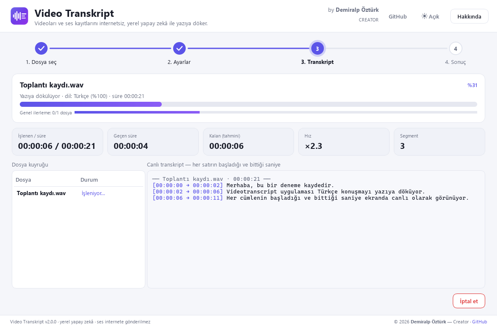
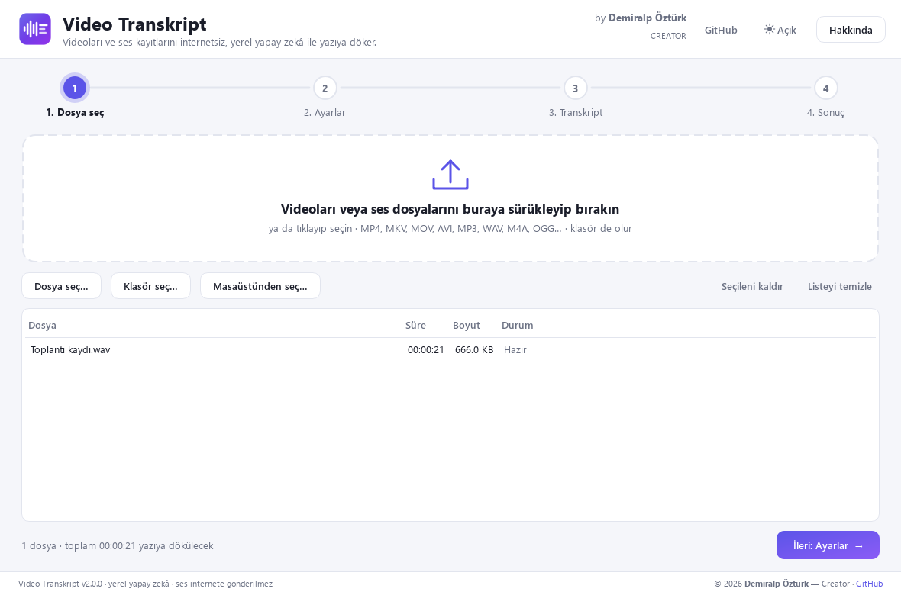
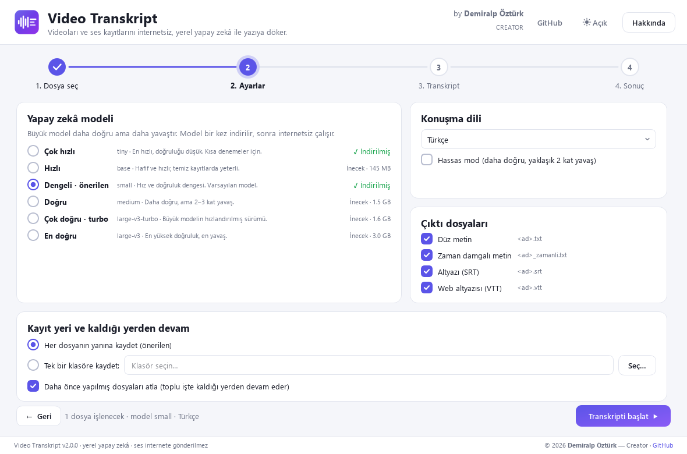
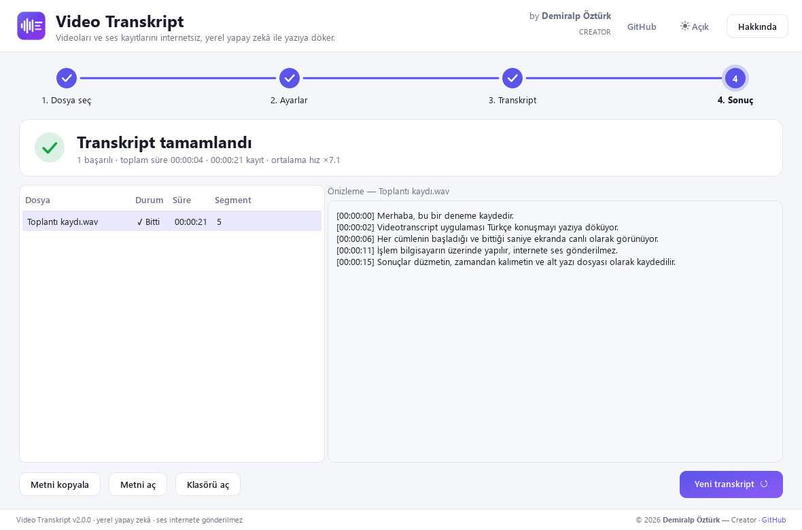
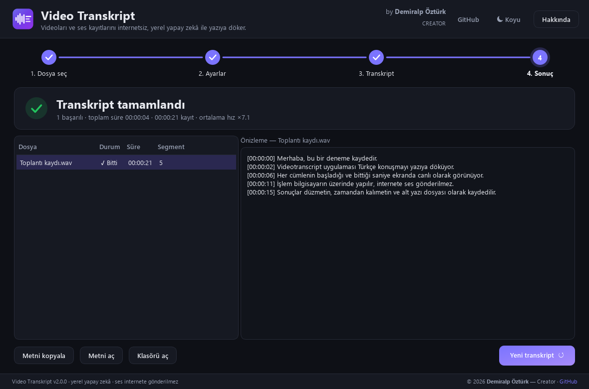

<p align="center">
  
</p>

<h1 align="center">Video Transkript</h1>

<p align="center">
  Videoları ve ses kayıtlarını <b>internetsiz, yerel yapay zekâ</b> ile yazıya döken Windows uygulaması.<br>
  <sub>Geliştiren: <b>Demiralp Öztürk</b> — Creator · <a href="https://github.com/demiralpozturk">GitHub</a></sub>
</p>

---



## Neler yapar?

- **4 adımlı akış:** 1 Dosya seç → 2 Ayarlar → 3 Transkript → 4 Sonuç
- **Dosya seçimi:** sürükle-bırak, çoklu dosya, klasör (alt klasörler dahil) ya da doğrudan Masaüstü'nden seçim
- **Canlı transkript:** her cümle `[00:01:23 → 00:01:27] metin` biçiminde, başladığı ve bittiği saniyeyle akar
- **Anlık durum:** dosya ilerleme çubuğu, geçen ve kalan süre, hız (×gerçek zaman), segment sayısı, dosya kuyruğu
- **Çıktılar:** düz metin (`.txt`), zaman damgalı metin (`_zamanli.txt`), altyazı (`.srt`), web altyazısı (`.vtt`)
- **Toplu iş ve kaldığı yerden devam:** yapılmış dosyalar atlanır; yalnızca `.srt` varsa eksik çıktılar
  yeniden transkript yapılmadan tamamlanır; yarım kalan dosya iz bırakmaz
- **Gizlilik:** ses bilgisayardan çıkmaz; yalnızca ilk kullanımda seçilen model indirilir
- **Açık / koyu tema** (sistemi izler), Türkçe arayüz, iptal, metni kopyala, klasörü aç

| 1 · Dosya seç | 2 · Ayarlar |
|---|---|
|  |  |
| **4 · Sonuç** | **Koyu tema** |
|  |  |

## Modeller

| Model | Boyut | Not |
|---|---|---|
| tiny | 75 MB | En hızlı, doğruluğu düşük |
| base | 145 MB | Hafif, temiz kayıtlarda yeterli |
| **small** | 484 MB | **Varsayılan** — hız/doğruluk dengesi |
| medium | 1.5 GB | Daha doğru, 2–3 kat yavaş |
| large-v3-turbo | 1.6 GB | Büyük modelin hızlı sürümü |
| large-v3 | 3.0 GB | En doğru, en yavaş |

Modeller `%LOCALAPPDATA%\VideoTranskript\models` altına iner. Daha önce komut satırı sürümüyle
indirilmiş model (Hugging Face önbelleği) varsa yeniden indirilmez.

## Kullanım

`dist\VideoTranskript\VideoTranskript.exe` dosyasını açın ya da dosyaları exe'nin / masaüstü kısayolunun üzerine
bırakın. Komut satırı:

```text
VideoTranskript.exe [dosya veya klasör ...]                 arayüzü açar, dosyaları listeye ekler
VideoTranskript.exe --selftest [--model tiny] [--rapor yol]  pencere açmadan uçtan uca deneme
VideoTranskript.exe --ekran-goruntusu KLASÖR                 her adımın ekran görüntüsünü alır
```

`--selftest` Windows'un Türkçe sesiyle bir deneme kaydı üretir, yazıya döker, dört çıktıyı, kaldığı yerden
devam etmeyi ve eksik çıktı tamamlamayı doğrular; raporu `%LOCALAPPDATA%\VideoTranskript\selftest.log`'a yazar.

## Derleme

```powershell
powershell -ExecutionPolicy Bypass -File build.ps1 -Kisayol
```

Python 3.12, `requirements.txt` ve PyInstaller gerekir. Çıktı: `dist\VideoTranskript\` (onedir) ve
masaüstünde **Video Transkript** kısayolu. Yapımcı bilgileri (LinkedIn, e-posta) tek yerde: `app_info.py`.

| Dosya | Görev |
|---|---|
| `motor.py` | Ses çözme, model indirme/yükleme, transkript, çıktı yazma, devam mantığı (arayüzden bağımsız) |
| `arayuz.py` | PySide6 arayüzü, tema, adımlar, iş parçacığı |
| `main.py` | Giriş noktası, `--selftest` |
| `deneme.py` | Self-test için Türkçe deneme kaydı (Windows konuşma sentezi) |
| `ikon.py`, `araclar/ikon_uret.py` | Uygulama simgesi |
| `app_info.py` | Ad, sürüm, yapımcı ve bağlantılar |

## English

**Video Transkript** is a Windows desktop app that transcribes video and audio files **offline** with
[faster-whisper](https://github.com/SYSTRAN/faster-whisper). It has a four-step UI (select files → settings →
live transcript → results), drag & drop, batch processing with resume, live per-segment timestamps, progress,
elapsed/remaining time and real-time speed, and exports TXT, timestamped TXT, SRT and VTT. Audio never leaves the
computer; only the chosen model is downloaded once. Built with PySide6 and packaged with PyInstaller.

---

<sub>© 2026 Demiralp Öztürk — Creator. faster-whisper / CTranslate2 (MIT), OpenAI Whisper modelleri (MIT),
Qt for Python (LGPL).</sub>
